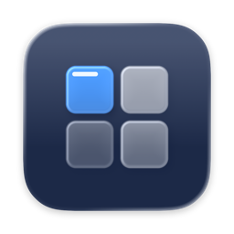
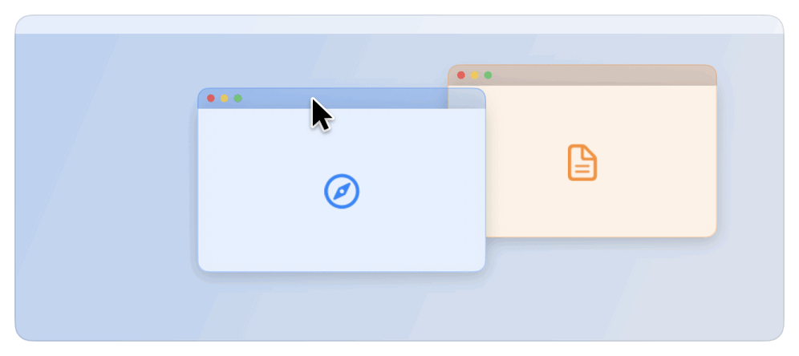
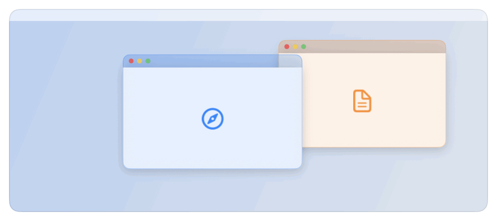

  

<h1 align="center">Karo</h1>

  Window management for macOS.

  
  

## Snap

Drag a window to a screen edge or corner to fill a half or a quarter. Karo then suggests windows for the free space.

<picture>
  <source media="(prefers-color-scheme: dark)" srcset="docs/images/scene-snap-dark.gif">
  
</picture>

## Place with the keyboard

| | |
|---|---|
| Left / right half | ⌃ + ⌥ + ← / ⌃ + ⌥ + → |
| Maximize | ⌃ + ⌥ + ↩ |
| Restore | ⌃ + ⌥ + ⌫ |

Quarters, thirds and more are in Settings, where every shortcut can be changed.

<picture>
  <source media="(prefers-color-scheme: dark)" srcset="docs/images/scene-keyboard-dark.gif">
  
</picture>

## Switch between windows

⌘ + Tab shows one icon per app. Karo's ⌥ + Tab shows every window, and right-click offers quick actions.

<picture>
  <source media="(prefers-color-scheme: dark)" srcset="docs/images/scene-switcher-dark.gif">
  
</picture>

## Install

Download the `.dmg` from the [latest release](https://github.com/ademaydemir/karo/releases/latest), open it and drag Karo to Applications. Karo needs macOS 14 or later and runs on Apple silicon and Intel Macs.

On first launch Karo asks for Accessibility permission, which it needs to move other apps' windows. It checks for updates once a day and asks before installing one.

## License

[MIT](LICENSE)
